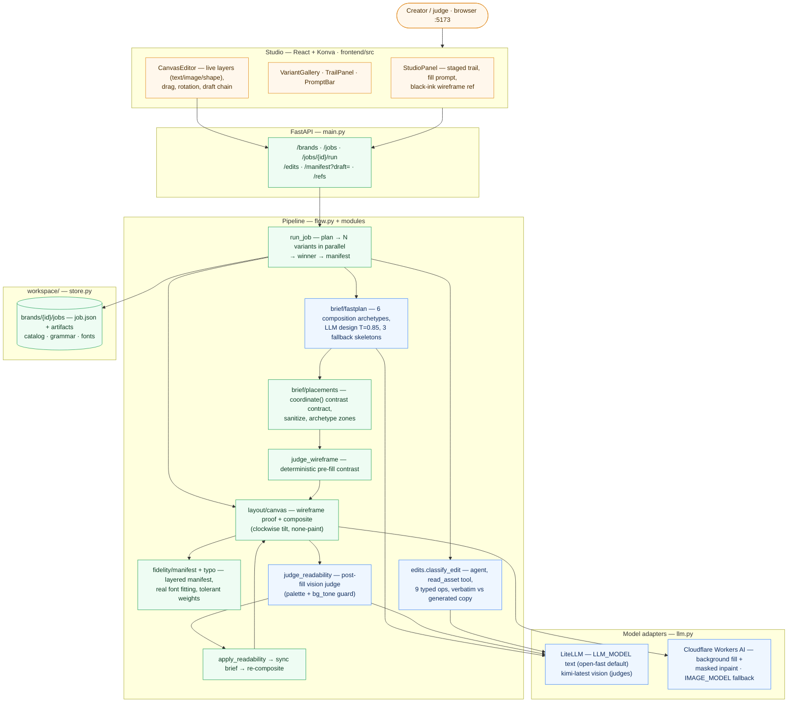

# Architecture

## Design thesis

The brief ranks **output quality first**. The old approach (image model paints
everything → strip text/logo out → paste layers back) fights constant drift:
garbled text, redrawn logos, whole-canvas changes, lossy strip. So the pipeline is
**layout-first**:

- **Models propose** (creative composition, copy, background scene, visual judgement).
- **Code enforces** (exact text/asset placement, paint semantics, colour contracts, separation).

The image model's only job is the background: it paints the **whole scene around
the pieces** from a wireframe reference, leaving clean colour fields under them.
Text and brand elements never enter it as content — divergence is not repaired,
it is **impossible**. The live pieces are composited on top in code and the
manifest layers **are** those pieces: separation by construction, nothing to strip.

## System overview



**Reading the diagram:** everything green is deterministic code — placement,
rendering, paint semantics, remedy application. Everything blue proposes or
judges. The image model (Cloudflare) touches **pixels only** for the background;
every glyph and brand element is drawn by `layout/canvas.py` / `fidelity/render.py`.

## Generation pipeline (one job)

`run_job` plans N concepts, then runs each variant in a worker thread
(ThreadPoolExecutor) — each variant is a full pipeline:

```mermaid
flowchart LR
    classDef model fill:#eef6ff,stroke:#3b82f6,color:#0f2c5c
    classDef code fill:#eefcf3,stroke:#22a05a,color:#0d3b22
    classDef warn fill:#fff1f0,stroke:#d64545,color:#5c0d0d

    A["Plan N archetypes<br/>LLM T=0.85 · else 3 skeletons"]:::model --> B["Contact sheet<br/>element refs + why"]:::code
    B --> C["judge_wireframe (det)<br/>label vs container · text vs field"]:::code
    C --> D["Wireframe proof<br/>pieces on plain canvas<br/>text = BLACK INK (model ref)"]:::code
    D --> E["fill_background<br/>model paints the WHOLE scene<br/>+ clean flat colour fields"]:::model
    E -->|429 / error| F["flat-field fallback<br/>fields painted exactly"]:::warn
    E --> G["render_composite<br/>bg at the bottom,<br/>live pieces on top"]:::code
    F --> G
    G --> H{"judge_readability (vision)<br/>palette-coordinated remedies<br/>allow_bg = false"}:::model
    H -->|flags| I["apply_readability<br/>bg_tone guard · hollow shapes<br/>recolor stroke, not fill"]:::code
    I --> J["sync remedies into brief<br/>re-composite"]:::code
    J --> K["variant done"]:::code
    G -->|no flags| K
    K --> L{"winner = deepest layout"}:::code
    L --> M["manifest.json<br/>raster + shape + image + text"]:::code
    M --> N["Konva canvas — editable forever<br/>drafts: generated → edit-1 → …"]:::code
```



Failure containment: contact sheet, fill, and the readability judge are each
wrapped — a failure degrades that stage (skip / flat fields / no remedies) and the
variant still ships. A variant that dies logs the traceback tail to `job.log`.

## Creative composition doctrine

The planner must produce layouts that **surprise** — not a stack of boxes on
shared margins. `brief/fastplan.py::COMPOSITIONS` gives the LLM six archetypes and
holds it to the doctrine below (design calls run at **temperature 0.85** —
style/structure/vibe calls stay at 0.4):

| Archetype | Structure |
|-----------|-----------|
| `diagonal_tension` | hero mass one corner, copy block counter-corner, band/ring along the diagonal |
| `editorial_rag` | strong left/right axis, asymmetric rag, generous column, one accent breaking it |
| `poster_center` | centered stack with extreme scale jump, one bold geometric accent behind |
| `collage_scatter` | 2–3 overlap-tilted pieces, cut-paper feel, text block as anchor |
| `split_world` | hard vertical/horizontal split — art one side, type the other |
| `negative_space_hero` | small dense cluster, vast quiet field, one bleeding accent |

Doctrine (enforced in the design prompt, verified in sanitize):

- **Scale drama** — hero type 40–70% of a dimension; no uniform-size layouts.
- **No margin monoculture** — text blocks stagger (x-gap ≥ 0.08) or span full width.
- **Designed eye-path** — entrance piece → promise → proof → CTA.
- **ONE mandatory rule-break** per design: (a) a piece bleeds past the canvas edge
  (≤0.02), (b) two pieces overlap (decor under a text corner), or (c) one piece is
  tilted `style.rotation` **−14..14 degrees, clockwise, pivoting on the piece
  centre — never on text** (sanitize strips text rotation).
- **Pool of calm** — quiet zone around the primary text block.
- **Logo with intent** — corner anchor / spine end / center-top; never floaters
  (if the catalog has no logo, the planner says so and uses a decorative accent
  instead — `accent_ring`, `accent_circle`).
- **Every shape carries meaning** (`cta_pill`, `band`, `accent_ring`, `color_band`,
  `vertical_spine`…) — never a filler blob. A stroke-only ring is
  `fill: "none"` + a hex stroke.

## Colour coordination & readability (the judges chain)

Text has **no box behind it — only font colour** — so contrast is carried by
planned/painted fields and enforced at three checkpoints:


- **`bg_tone` guard** — the vision model reports the backdrop tone behind each
  flagged piece (`light`/dark) and a proposed ink. If the proposal has the wrong
  luminance for that tone (white-on-light, navy-on-dark — the classic vision
  misread), code replaces it with the readable ink of the right tone from the
  **brand palette** (`_tone_ink`), generic ivory/ink only as fallback.
- **allow_bg=false** (generation) — `target:"background"` flags are demoted to
  text remedies: there is no second fill, so the ink/container must give.
  The edit flow allows background targets → they become **field overrides** for a
  targeted repaint.
- **Hollow shapes** recolour their **stroke**, never their fill — a gold accent
  ring stays a ring (the old `"none"` fill silently coerced to a black blob;
  `"none"`/`null`/`transparent` now mean **no paint** everywhere: `canvas._paint_color`,
  Konva `noPaint`).
- Remedies are **synced back into `brief.placements`** and the composite is
  rebuilt — the manifest, the Konva canvas and the trail all see the fixed state.

## The layout-first contract (fidelity core)

1. **Classify** (`ingest/groups.py`) — every asset is `element` (placeable: logo,
   charm, icon, shape, UI card) or `reference` (full image/scene → inspiration +
   palette examples, never placed). Colourway variants of one element share a
   `colorway_group` ("Xero Logo - White/Navy/Light Blue" → `logo_xero`).
2. **Plan** (`brief/fastplan.py` + `brief/placements.py`) — placements with exact
   copy + font colours + element ids (colourway-coordinated) + shapes + `bg_fields`
   (per-region colour control for the fill prompt). `sanitize_placements` drops
   duplicate copy, clamps text boxes strictly inside the canvas (pieces may bleed
   ±0.02), validates image ids against the catalog, and field-ties go to the
   **smallest** overlapping field (most specific wins).
3. **Wireframe** (`layout/canvas.py::render_layout`) — the proof renders the REAL
   pieces (brand font text, exact PNGs, shape fills) on a plain canvas. This is
   also the **reference image** for the fill. Convention: wireframe text is drawn
   as **black ink** (structure only — the studio labels it "black-ink ref"); real
   ink colours land in the composite.
4. **Fill** (`compose/fill.py`) — `llm.edit_image(prompt, wireframe, strength=0.8)`
   paints the **entire canvas** as one scene (people, products, environments,
   illustration accents are all drawable) and must leave each `bg_field` a clean
   flat colour of its exact hex. The prompt carries the scene story, the field
   contract, the brand palette and a hard ban on text/letters/logos/UI (the model
   gets lettering wrong — the real copy is pasted afterwards). On API failure /
   429 the fields are painted as exact flat colours (guaranteed-readable fallback).
5. **Composite + judge** — pieces pasted on top in code; the post-fill vision
   judge applies the smallest remedy per unreadable piece (see chain above).
6. **Manifest** (`fidelity/manifest.py`) — separation by construction: layer 0 =
   background raster, then shape/image/text layers at their planned px boxes
   (text pre-fitted with real font metrics via `fit_text_block` — what the proof
   and the judge saw). Style numbers are read **tolerantly** (`as_weight`:
   `700`, `"700"`, `"bold"` all work; `as_int` for size/padding/strokeWidth) so a
   creative LLM response can never crash a render.

## Edit semantics

`edits.py::classify_edit` is a **tool-using agent** (`chat_agent`, model `pro` →
`LLM_MODEL`): it sees every layer (role, content, bbox, colour), the full brand
catalog inline, and can call **`read_asset(asset_id)`** to VIEW candidates before
choosing. Ops in application order:

| Op | Effect |
|----|--------|
| `change_text` / `add_text` | rewrite/insert copy — `mode: verbatim` (quoted) vs `generated` (agent writes the finished copy) |
| `change_color` / `edit` | recolour a text or shape layer (partial restyle: content, colour, rect, size_scale, asset) |
| `reposition` | move/resize (a `cta_pill`/`cta_bg` rides with its label via role pairing) |
| `change_asset` / `add_asset` | swap/place a catalog element (`asset_id` from `read_asset`, `query` = RAG fallback) |
| `remove` | delete a layer |
| `change_background` | repaint the BACKGROUND raster only (at most one per request) |

`change_background` runs the same lines as generation: the updated layers render as
a black-ink wireframe (`wire_from_manifest`) + a prompt describing the new scene
and the colour fields derived from the **live** inks (so a recoloured label
automatically re-specifies its field). Only `design_src` is swapped — live layers
are untouched. A masked inpaint variant (`sd1.5-inpainting` + `composite_back`)
enforces pixel-identical pixels outside the edit window.

Drafts chain via `parent` (`generated`, `edit-1`, …); old jobs stay editable
(`_ensure_generated` backfills the root draft — only on **finished** jobs, so a
live run's state can never be clobbered by a stale snapshot).

## Judging — what actually runs

| Judge | Type | When | Remedies |
|-------|------|------|----------|
| `judge_wireframe` (`edits.py`) | deterministic | pre-fill, per variant | label ink flip vs its container (cr<3) · **field colour** flip vs overlapping text |
| `judge_readability` (`edits.py`) | vision `kimi-latest` | post-fill on the real composite | text ink · container fill/stroke · (edit flow) background field overrides — with `bg_tone` + palette |
| `validate_affinity` (`brief/shortlist.py`) | deterministic | planning | warnings only (missing logo, boldness vs density) |

`layout/judge.py` keeps the det+vision **perfect loop** (`judge_layout` /
`perfect_layout` — bounds, overlap, fit, contrast, clearspace + hierarchy/balance
critique) but is not on the default hot path; the readability chain above is.

## Model split (strict)

| Adapter | Model | Role |
|---------|-------|------|
| `llm.chat_text` | `LLM_MODEL` (`open-fast` default; `pro`/`thinking`/`flash` resolve to it) | copy, archetypes/ideas, design specs (T=0.85), edit classification |
| `llm.chat_vision` | `kimi-latest` | readability judge (typed pieces payload + composite image) |
| `llm.chat_agent` | `pro` → `LLM_MODEL` + `read_asset` tool | edit ops planning with visual asset choice |
| `llm.edit_image` | Cloudflare Workers AI (wireframe-reference fill; `sd1.5-inpainting` masked repaint) — `IMAGE_MODEL` (`gemini-3.1-pro`) fallback | **all pixel work** — backgrounds only |

## Job state & concurrency

- Variants run in parallel threads; `job.log`/`job.trail` append under a lock and
  every save serializes the shared job object under the same lock — the trail is
  live-updated as each variant lands.
- `_ensure_generated` (GET job) and `finalize_job` only touch **done/failed**
  jobs. Before this guard, a GET mid-run could load-modify-save a stale snapshot
  and silently drop log lines/variant state (the class of bug fixed in `c4a774f`).
- State file: `workspace/brands/{brand_id}/jobs/{job_id}.json`; artifacts
  (`*_layout.png`, `*_bg.png`, `*_design.png`, `manifest.json`, contact sheets)
  live in the sibling `jobs/{job_id}/` directory.

## Module map

```
backend/app/
  flow.py               orchestration: plan → wireframe → fill → composite → judge → manifest
  llm.py                chat_text / chat_vision / chat_agent / edit_image (ref) / inpaint (mask)
  edits.py              edit agent + 9 ops · judge_wireframe · judge_readability · repaint
  main.py               FastAPI routes (jobs/run, edits, manifest?draft=, refs)
  store.py              brand CRUD, catalog query, job persistence (jobs/{id}.json)
  models.py             Brief · Placement · BgField · Manifest Layer · Job/Variant/EditDraft
  brief/cohorts.py      deep-thinking planner (DEEP_PLAN=1) — zones bridged to placements
  brief/fastplan.py     COMPOSITIONS archetypes + DESIGN_SYSTEM doctrine · llm + skeleton fallback
  brief/placements.py   skeletons/zones · coordinate() contrast math · sanitize · field_for
  brief/copywriter.py   copy block variants (verbatim vs generated semantics upstream)
  brief/contact.py      contact sheet of element refs per brief
  brief/shortlist.py    validate_affinity (logo/boldness/element warnings)
  layout/canvas.py      wireframe proof / composite — one drawing core
                        (rotation = clockwise° around piece centre · _paint_color "none"=no paint)
  layout/judge.py       det+vision layout judge + perfect loop (off the default hot path)
  compose/fill.py       bg_prompt (scene + field contract + palette + no-text ban) · fill · flat-field fallback
  compose/prompts.py    size helpers + legacy bake prompts
  fidelity/manifest.py  layered manifest builder (bg + shape + image + text, pre-fitted text)
  fidelity/typo.py      font resolution + text fitting + as_weight/as_int tolerant coercion
  fidelity/render.py    manifest → flattened preview (rotation passthrough, hollow-stroke aware)
  ingest/               pipeline · classify (element|reference + colorway) · groups · quality · fonts · verify
  imutil.py             SVG → PNG (cairosvg → qlmanage)
  archive/              the old generate-then-strip path (wireframe/composer/critic/
                        layout_tune/textfit/match) — reference only, never imported
frontend/src/
  pages/                Brands · BrandHome (assets) · Jobs · Create · Job (trail) · Edit
  components/           StudioPanel (staged trail + fill prompt + black-ink ref label) ·
                        CanvasEditor (Konva: raster/shape/image/text, rotation, noPaint) ·
                        VariantGallery (final composites) · TrailPanel · PromptBar · JudgeDiffPanel
  api.js                REST client + workspace file URLs
workspace/              runtime data (brand kits under assets/ — not shipped; jobs under brands/)
```

## Known constraints

- **Free fill model garbles letterform echoes** — the prompt bans text, but the
  free Cloudflare model sometimes echoes the wireframe's black-ink glyphs as
  background "art". Live text still reads (it's pasted on top, then judged), but
  the scene can look noisy. Mitigations in place: black-ink wireframe convention,
  field contract with exact hexes, `bg_tone` guard, flat-field fallback. The fill
  prompt is shown in the studio — **copy it into a stronger image model** for
  production-grade scenes (a supported workflow).
- 429 "Capacity temporarily" from the free tier is common → automatic flat-field
  fallback (fields painted exactly = guaranteed readable, zero artwork).
- Text layers use the brand font when a real font file resolves; otherwise the
  fallback face (metric-similar) — `typo.resolve_font_path`.
- `judge_readability` swallows transport errors into an empty flag list (a bad
  image path reads as "everything is fine") — known footgun, flagged for hardening.
- Sizes: fill canvases 1024²-class per ratio; boxes normalized `[x,y,w,h]`
  fractions in specs, px `[x,y,w,h]` in manifest layers.
- The archived generate-then-strip path lives under `app/archive/` for reference
  (re-skin of pre-existing flat designs is out of scope for the layout-first path).

## Update log

| Commit | Updates |
|--------|---------|
| `7a14c69` | wireframe-driven compose, text replace pass, screenshot-critique overlay fitting (pre-fill-repaint) |
| `bdfb901` | docs: architecture notes |
| `d0f1ae4` | **wireframe-to-fill pipeline** (fill paints the whole scene around pieces — masked inpaint/hole-fill retired), **op-based edit agent** (9 ops, `read_asset` tool, verbatim vs generated copy), **studio + recipe UX** (staged trail, copyable fill prompt, ref image) |
| `19f355f` | **creative composition archetypes** (6 COMPOSITIONS + rule-break doctrine: bleed / overlap / tilt −14..14° clockwise piece-centred, never text), **piece tilt rendering** (PIL + Konva centre-pivot), **post-fill readability judge** (vision remedies on the real composite) |
| `c4a774f` | **hollow-shape paint fix** (`"none"`/`null`/`transparent` = no paint — kills black blobs/outlines in PIL + Konva), **tone-guarded readability remedies** (`bg_tone` + palette coordination, `allow_bg=false` in generation, hollow shapes recolour stroke), **tolerant font weights** (`as_weight`/`as_int` — `"bold"` no longer crashes renders), **race-free job saves** (finished-jobs-only guards on `_ensure_generated`/`finalize_job`, locked final save, traceback on variant failure) |
