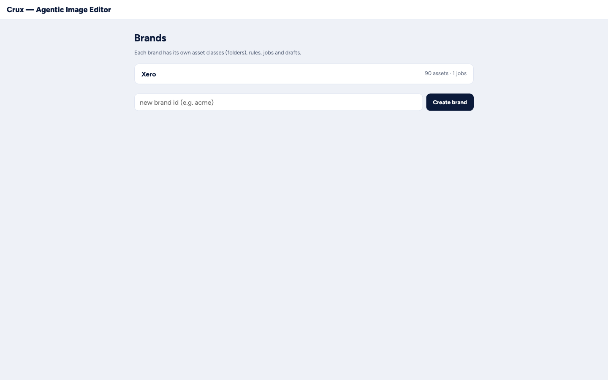
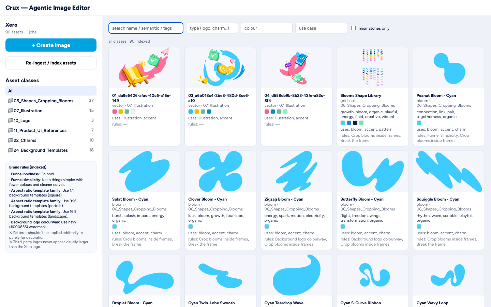
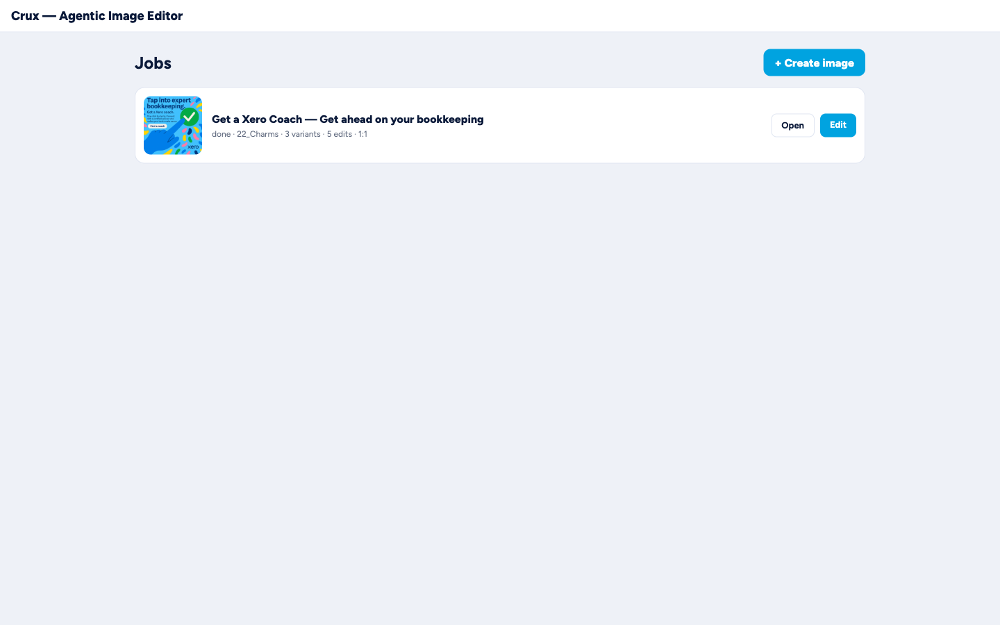
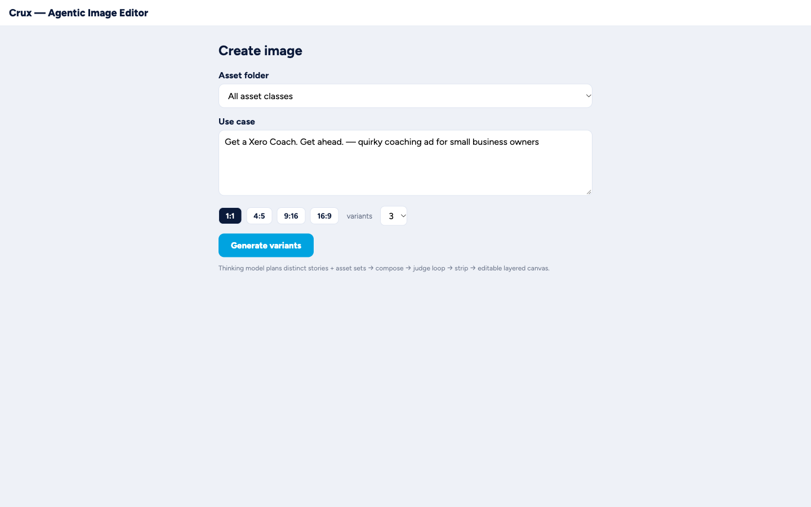
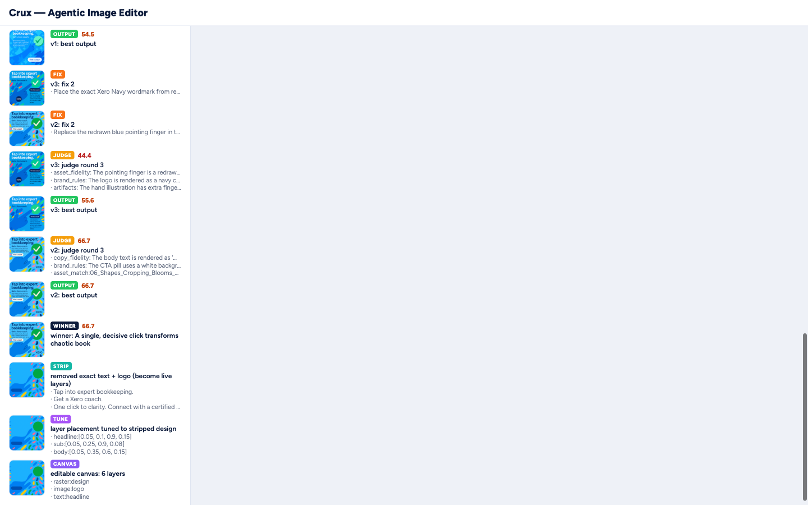
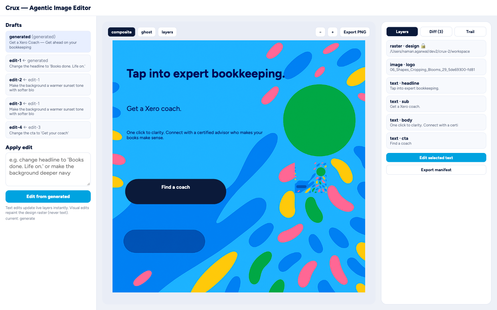
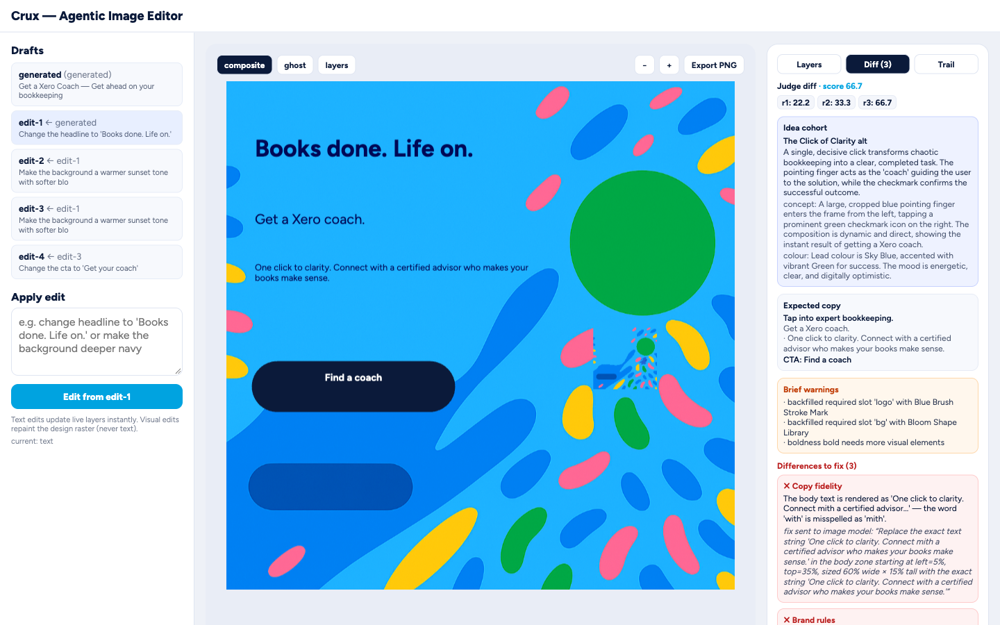

# View test report

_Generated 2026-10-17 12:45 UTC · 41/41 checks passed · backend :8000, frontend :5173_

Route coverage: brands list · asset intelligence · jobs panel · create · job trail · edit canvas (incl. draft switch) · API smoke.

## 1. Brands /

| Check | Result |
|-------|--------|
| lists brand xero | ✅ PASS |
| create-brand form present | ✅ PASS |
| brand row links to /b/xero | ✅ PASS |

## 2. Brand home /b/xero

| Check | Result |
|-------|--------|
| folder tree shows 06_Shapes_Cropping_Blooms | ✅ PASS |
| folder tree shows 22_Charms | ✅ PASS |
| search + filters present | ✅ PASS |
| asset grid renders (90 thumbs) (90) | ✅ PASS |
| brand rules panel | ✅ PASS |
| create + jobs entry points | ✅ PASS |
| search narrows grid (51 of 90) | ✅ PASS |

## 3. Jobs /b/xero/jobs

| Check | Result |
|-------|--------|
| lists the seeded job | ✅ PASS |
| Open action present | ✅ PASS |
| Edit action present (done job) | ✅ PASS |

## 4. Create /b/xero/new

| Check | Result |
|-------|--------|
| use case textarea prefilled | ✅ PASS |
| ratio buttons | ✅ PASS |
| variants control | ✅ PASS |
| asset folder select loaded | ✅ PASS |
| Generate button | ✅ PASS |
| no horizontal overflow | ✅ PASS |

## 5. Job /b/xero/j/:id

| Check | Result |
|-------|--------|
| progressive trail present | ✅ PASS |
| trail shows pipeline stages | ✅ PASS |
| variant gallery cards | ✅ PASS |
| winner score visible | ✅ PASS |
| Edit → CTA to canvas | ✅ PASS |

## 6. Edit /e/generated

| Check | Result |
|-------|--------|
| draft chain listed | ✅ PASS |
| instruction input present | ✅ PASS |
| edit button targets draft | ✅ PASS |
| konva canvas mounted | ✅ PASS |
| mode buttons composite/ghost/layers | ✅ PASS |
| export PNG | ✅ PASS |
| diff tab shows judge checks | ✅ PASS |
| trail tab streams stages | ✅ PASS |
| layers tab lists raster/text | ✅ PASS |
| draft edit-1 opens + button says Edit from edit-1 | ✅ PASS |

## 7. API

| Check | Result |
|-------|--------|
| health 200 | ✅ PASS |
| brands 200 | ✅ PASS |
| assets 200 | ✅ PASS |
| jobs 200 | ✅ PASS |
| job 200 | ✅ PASS |
| manifest 200 | ✅ PASS |
| no page errors | ✅ PASS |

## Screenshots















## Reproduce

```bash
cd backend && .venv/bin/python ../workspace/serve.py &
cd frontend && npm run dev &
NODE_PATH=<playwright>/node_modules node <view_test.cjs>
```
