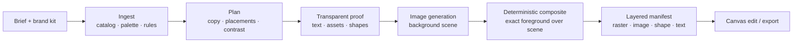
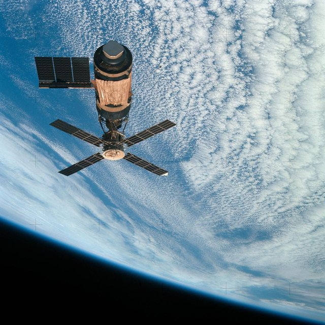
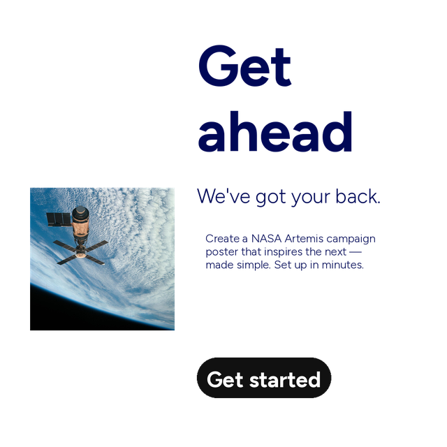
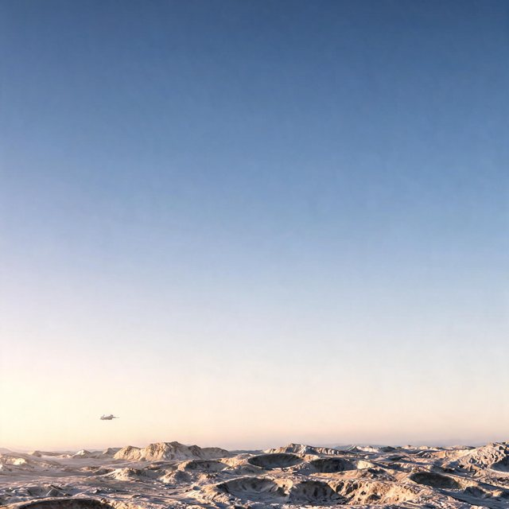
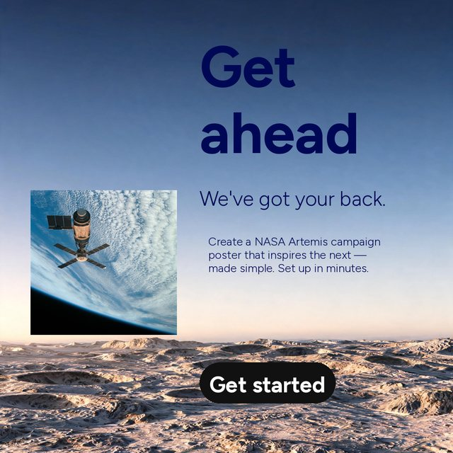
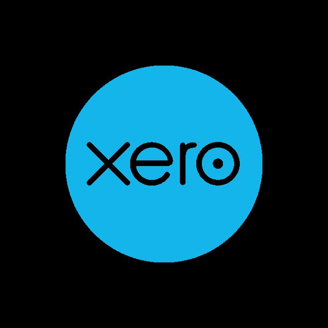
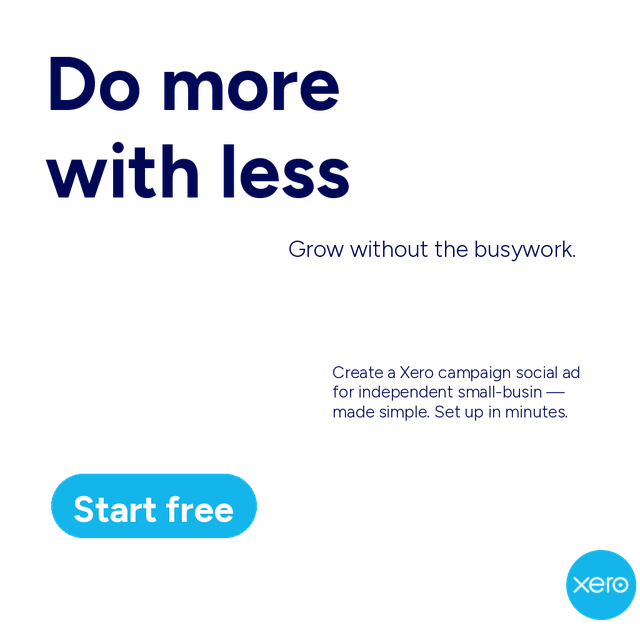

# Crux: from brand kit to editable creative

Crux turns a campaign brief and a brand kit into image concepts whose layout,
copy, and brand assets remain editable after generation. Its defining choice is
to plan and render the foreground **before** generating pixels.

> **Models propose; code owns fidelity.** The image model creates a scene. The
> renderer owns the exact copy, placement, selected brand assets, and final layer
> structure.

## The pipeline at a glance

```text
Brief + brand kit
  → Ingest: assets, metadata, palette, typography, rules
  → Plan: concept, exact copy, placements, contrast intent
  → Proof: transparent PNG of the foreground at final positions
  → Generate: background scene guided by the proof
  → Composite: exact text + brand assets + shapes over the generated scene
  → Package: editable manifest and canvas
  → Edit: change copy, geometry, assets, or background independently
```



## Stage inputs and outputs

| Stage | Input | Output | What stays deterministic |
|---|---|---|---|
| **Ingest** | Brand-kit images, vector marks, optional rules | Brand catalog, normalized assets, palette and metadata | Source asset identity and recorded metadata |
| **Plan** | User brief, brand catalog and rules | One or more concepts with copy, selected assets, rectangles, styles and background intent | Planned copy and layer geometry |
| **Proof** | Planned concept | Transparent PNG showing foreground at final positions | Text glyphs, font/color, asset pixels, shapes and z-order |
| **Generate** | Proof/reference plus scene prompt | Background image | The model controls generated pixels; it may echo reference details |
| **Composite** | Background plus plan | Final raster preview | Exact planned foreground is drawn by application code |
| **Package** | Plan and image paths | JSON manifest with editable layer records | Layer types, content, bounds, styles and asset references |
| **Edit** | Existing manifest and user instruction | Updated draft/manifest and preview | Supported text, image, shape and background operations are applied to their corresponding layers |

### Current image-model path

- **Configured default for new Fal image edits:** `fal-ai/bytedance/seedream/v5/lite/edit`
- **Configured Fal text-to-image fallback:** `fal-ai/bytedance/seedream/v5/lite/text-to-image`
- **Backend selector:** `IMAGE_BACKEND=fal`
- Model routes can be overridden with `FAL_IMAGE_MODEL` and `FAL_T2I_MODEL`.

The model is responsible for the background, not exact copy composition. For an
edit, Crux sends the transparent proof as the visual reference and asks for a
text-free scene around the mapped foreground. Since edit models can copy or
reinterpret visible reference pixels, the final compositor draws the real text
and assets again. That preserves the exact foreground but **does not guarantee**
that the model never echoes it in the background.

The clean examples below use Seedream 5.0 Lite **text-to-image** backgrounds,
then composite the planned foreground. This avoids exposing visible copy to the
image model for these demonstration images. It is intentionally distinct from
the configured **Edit** default used for new jobs.

## Example stages

These are independently created illustrative concepts, not official NASA or
Xero campaigns. The page uses curated static exports; it does not need job
records, a database, or brand catalogs at runtime.

| Example | Brand input | Transparent plan | Generated background | Final composite |
|---|---|---|---|---|
| **NASA / Artemis** |  |  |  |  |
| **Xero / small business** |  |  |  |  |

Transparent proof images are PNGs. The website places them on a CSS checkerboard
so it is clear that black is not the canvas background; it is transparent space.

## What can be produced and edited

- Multiple layout concepts from one brief, including square, portrait, story and
  landscape aspect ratios.
- Brand-oriented social ads, campaign posters, promotional tiles, and other
  image-and-copy compositions.
- Live text layers with exact strings, font styling, color, alignment and bounds.
- Separate image layers for brand assets, separate shape layers, and a
  background raster.
- Iterations that target copy, geometry, asset selection, or background rather
  than regenerating a flattened final.
- Stage artifacts for inspection: layout proof, model reference, fill prompt,
  generated background, final composition and manifest.

## Artifact structure

Generated runtime jobs are stored under:

```text
workspace/brands/<brand-id>/jobs/<job-id>/
├── <variant>_layout.png       # transparent foreground proof
├── <variant>_bg_wire.png      # recorded reference used for background fill
├── <variant>_bg.png           # generated background raster
├── <variant>_design.png       # preview composite
└── manifest.json              # background + editable layer descriptions
```

The manifest represents the final composition as a background raster plus typed
layers (`image`, `shape`, and `text`). The editor can therefore change an
individual piece without treating the whole design as one image.

The workflow page is a static React view at `/workflow`. Its images live in
`frontend/public/workflow/examples/`, so deploying the frontend does not require
copying workspace asset catalogs or job/database state.
